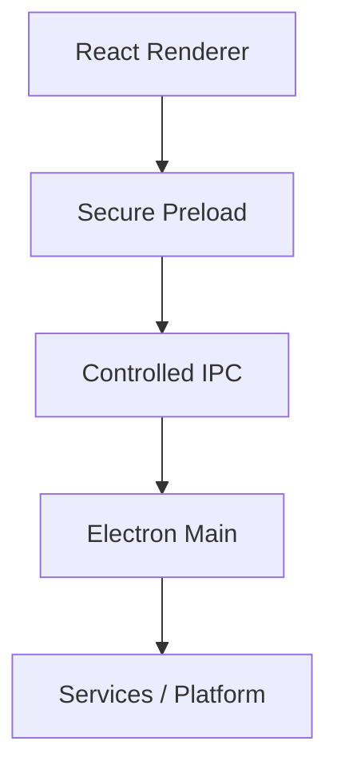
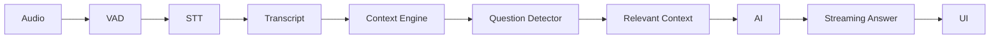
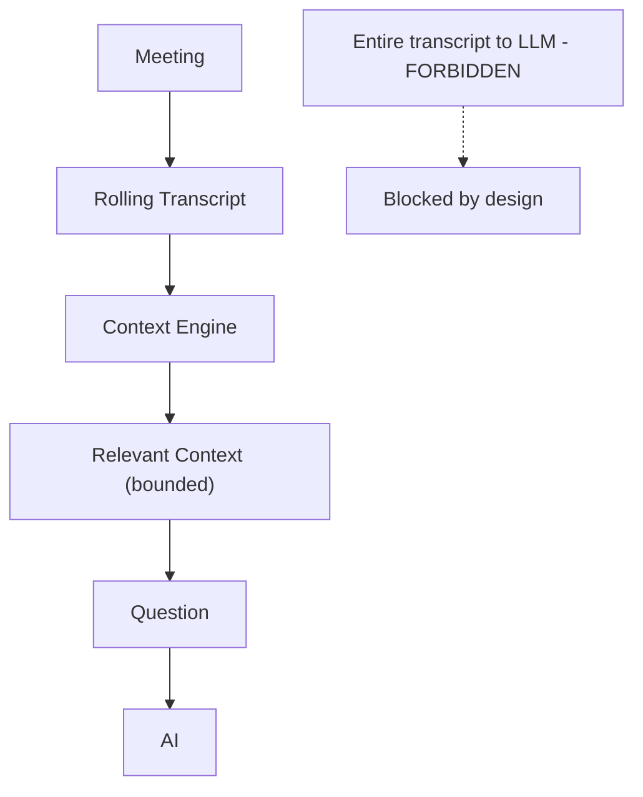

# CallSense - Architecture Diagrams

All diagrams are Mermaid. The canonical source of truth is
`../architecture.md`; this folder is an index of the diagrams used across
the architecture documentation.

| Diagram | Location |
|---|---|
| System architecture (full) | `../architecture.md` section 2, `../system-architecture.md` section 2 |
| Real-time pipeline | `../architecture.md` section 4, `../realtime-pipeline.md` section 1 |
| Question detector flow | `../architecture.md` section 11 |
| Capture protection flow | `../architecture.md` section 7, `../security-architecture.md` section 8 |
| Local vs cloud AI flow | `../architecture.md` section 13, `../system-architecture.md` section 10 |
| IPC round trip | `../architecture.md` section 18, `../system-architecture.md` section 6 |

## Core boundary diagram

## Pipeline diagram

## Context flow (bounded by design)

