# CallSense - Real-Time Pipeline

**Status:** Phase 0 - intended architecture only; the pipeline is built
incrementally across Phases 2-8, not now.
**Source of truth:** `docs/architecture/architecture.md`

## 1. Pipeline overview

```text
Audio
|
v
VAD
|
v
STT
|
v
Transcript
|
v
Context Engine
|
v
Question Detector
|
v
Relevant Context
|
v
AI
|
v
Streaming Answer
|
v
UI
```



```mermaid
flowchart LR
    Mic["Microphone"] --> Capture["Audio Capture"]
    Capture --> VAD["Voice Activity Detection"]
    VAD --> STT["Speech-to-Text"]
    STT --> Buffer["Transcript Buffer"]
    Buffer --> Context["Context Engine"]
    Context --> Detector["Question Detector"]
    Detector --> Package["Question + Relevant Context"]
    Package --> AI["AI Service"]
    AI --> Stream["Streaming Response"]
    Stream --> UI["Answer UI"]
```

## 2. Stage-by-stage explanation

### 2.1 Audio

`AudioService` (Electron Main, via `PlatformService`) captures microphone
input first; system audio and combined capture are later milestones
because capture APIs and permissions differ per OS. Audio lives in memory
only: it is processed and discarded (see Privacy, section 6). Conceptual
interface: `startListening / stopListening / pauseListening` plus
started/stopped/error events.

### 2.2 VAD (Voice Activity Detection)

A cheap gate placed *before* expensive processing where practical. It
ignores silence, emits speech-started / speech-stopped events, and prevents
STT from burning CPU on quiet audio. VAD is a boundary owned by the audio
phase; no VAD runtime is installed in this phase.

### 2.3 STT (Speech-to-Text)

`TranscriptionService` converts speech to text through a replaceable
provider (local whisper.cpp-compatible runtime or optional cloud STT).
Conceptual interface: `start / stop / processAudio` with
`onPartialTranscript / onFinalTranscript / onError`. Swapping the provider
must not change the Context Engine or the UI.

### 2.4 Transcript

The transcript buffer distinguishes:

- **Partial transcript** - still changing.
- **Final transcript** - stable recognized speech.
- **Context transcript** - processed information retained for reasoning.

Rules: use stability/debounce before question detection, and **never fire
an AI request for every partial transcript update**.

### 2.5 Context Engine

Maintains rolling context in two conceptual levels:

- **Immediate context** - recent conversation, roughly 30-120 seconds
  initially; exact size must be benchmark-driven.
- **Important context** - longer-lived facts: technologies, scale,
  architecture, constraints, current problem, decisions.

It also tracks the **current topic** and emits `context.updated`. It never
retains an unlimited transcript for the AI prompt.

### 2.6 Question Detector

A lightweight, deterministic layer first (no LLM classification
calls). Signals: question mark, interrogative words, sentence structure,
direct requests, conversational context, transcript stability. It runs
only on *stable* transcript and emits `question.detected` /
`question.updated` with confidence. Question detection is fully separated
from AI: it decides *whether* to ask; the AIService decides *how* to
answer.

### 2.7 Relevant Context (packaging)

Before any AI request, a compact package is assembled:

```text
Relevant context:
- technology
- scale
- constraints
- current topic
- important decisions
- recent relevant statements

Question:
<detected question>

Answer requirements:
- concise
- direct
- technically useful
- use only relevant context
```

This reduces token use, latency, cost, and irrelevant model input.

### 2.8 AI

`AIService` streams from the selected local or cloud provider using the
package above. If the question changes, the stale request is aborted
(`AbortController` or provider-equivalent):

```text
Question A -> Request A -> question changes -> abort A -> Question B -> Request B
```

### 2.9 Streaming Answer

Preferred flow: question detected -> request starts -> first token ->
render immediately -> more tokens -> complete. Token rendering may be
batched for efficiency, but the first token must reach the UI as soon as
possible.

### 2.10 UI

The renderer reflects real service state, never fake progress:

```text
Idle -> Listening -> Transcribing -> Processing -> Generating -> Complete / Error
```

Visual pipeline: `Listen -> Transcribe -> Understand -> Answer`.

## 3. Context architecture (context model)

```text
Recent Context
+
Important Facts
+
Current Topic
+
Current Question
```

Intended flow:

```text
Meeting
|
v
Rolling Transcript
|
v
Context Engine
|
v
Relevant Context
|
v
Question
|
v
AI
```

Explicitly prevented (hard architectural rules):

```text
Entire meeting transcript -> LLM        [ FORBIDDEN ]
Every transcript character -> LLM       [ FORBIDDEN ]
```

Only the bounded, relevant-context package plus the current question may
reach an LLM.

## 4. Latency considerations and performance architecture

Requirements:

- VAD before expensive processing where practical.
- Transcript stability / debounce before detection.
- No LLM request for every partial transcript.
- Rolling (bounded) context - never unbounded growth per turn.
- Request cancellation for stale questions.
- Streaming responses with early first-token rendering.
- Efficient React updates (batch token rendering where necessary).
- Electron Main must remain responsive at all times.
- Expensive processing can later move to worker / utility processes when
  justified.
- Latency metrics must eventually be measurable (instrumentation lands in
  the production phase).

### Metrics

| Metric | Meaning |
|---|---|
| `questionDetectionLatency` | Stable transcript available -> question event emitted (includes debounce window). |
| `aiRequestStartLatency` | Question detected -> AI request issued. |
| `timeToFirstToken` | AI request issued -> first streamed token received. |
| `totalGenerationTime` | First token -> last token / completion. |
| `endToEndLatency` | Stable question -> first answer token rendered in UI. |

Performance anti-rules (from the blueprint): do not send the entire
meeting to AI; do not call AI for every transcript character.

## 5. Events produced along the pipeline

```text
audio.started / audio.stopped / audio.speech.started / audio.speech.stopped
transcript.partial / transcript.final / transcript.error
context.updated
question.detected / question.updated
ai.request.started / ai.token / ai.completed / ai.cancelled / ai.error
captureProtection.changed
```

Events are controlled and documented; they reach the renderer only via
preload subscriptions over controlled IPC.

## 6. Privacy in the pipeline (default behavior)

```text
Audio      -> memory -> processing -> discard
Transcript -> rolling context -> processing -> discard
```

No permanent audio or transcript storage is introduced during initial
implementation. Sensitive audio/transcript data must never be written to
logs (see `security-architecture.md`).

## 7. What is NOT built in this phase

No audio capture, VAD, speech recognition, transcript processing, question
detection, AI request, streaming, database, or real-time integration code
exists yet. Each stage above ships in its assigned phase only.