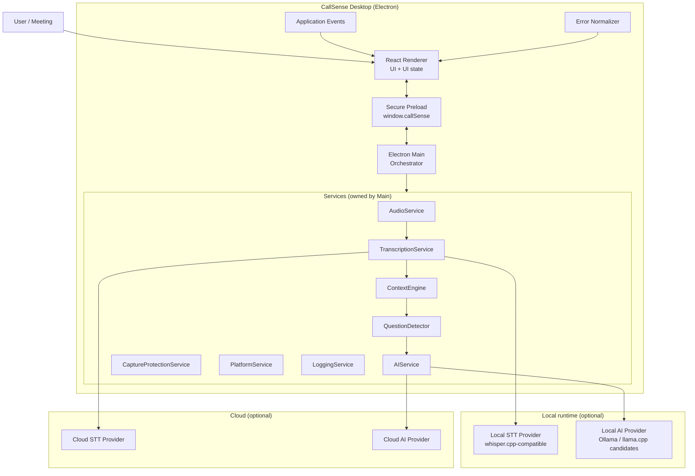
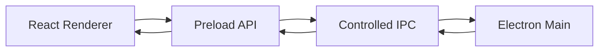

# CallSense - System Architecture

**Status:** Phase 0 - architecture only (no implementation code)
**Source of truth:** `docs/architecture/architecture.md` (canonical copy of the root blueprint)
**Stack:** Electron, React, Vite, JavaScript, Node.js, Tailwind CSS
**Platforms:** Windows-first, macOS second, Linux where practical

This document describes the *intended* architecture. Nothing here is built
before its assigned phase (see `architecture.md` sections 30 phases, 31
phase boundary rule, 33 non-goals).

## 1. Top-level boundaries

```text
React Renderer
    down
Secure Preload
    down
Controlled IPC
    down
Electron Main
    down
Services / Platform
```

Rules:

- React is UI only.
- React must **not** directly access Node.js, the filesystem, private API
  keys, OS APIs, or native audio APIs.
- Electron Main owns all desktop/native capabilities.
- Every renderer / main interaction crosses the preload boundary through a
  small, explicit, documented API.

## 2. Architecture diagram



## 3. Electron Main

Owns: application lifecycle, windows and always-on-top behavior, global
shortcuts, audio orchestration, platform integration, capture protection,
service lifecycle, AI orchestration, IPC, structured logging, error
boundaries.

Main must not become one giant file: window/shortcut code, IPC handlers,
platform code, and services live in separate modules (see section 12).

## 4. React Renderer

Owns: assistant window UI, transcript display, question display, answer
display, pipeline state, controls, settings UI, user-facing errors.

Final design rule: the UI requests capabilities; it never knows how audio,
transcription, context processing, question detection, or AI providers work
internally.

## 5. Preload

Exposes only a small, explicit API (illustrative, from the blueprint):

```text
window.callSense
  window.show() / window.hide() / window.toggle() / window.setAlwaysOnTop()
  audio.start() / audio.stop() / audio.pause()
  protection.enable() / protection.disable()
  ai.generateAnswer() / ai.cancel()
  events.onTranscript() / events.onQuestion()
  events.onAnswerToken() / events.onPipelineState()
```

Never expose unrestricted `require`, `fs`, `child_process`, or other Node
APIs to React. Created with `contextIsolation: true` and
`nodeIntegration: false`.

## 6. IPC



- Only documented, capability-oriented channels - never a generic "run
  anything" channel.
- Commands (renderer to main) and events (main to renderer) are distinct.
- Main validates payloads and the sending frame.
- Provider/service failures are normalized into structured errors and must
  never crash Electron.

## 7. Service boundaries

| Service | Responsibility |
|---|---|
| `AudioService` | Microphone / system / combined capture lifecycle; emits audio and transcript-update events; delegates all OS-specific capture to the platform layer. |
| `TranscriptionService` | STT orchestration behind a provider abstraction; partial and final transcript events; local or cloud provider. |
| `ContextEngine` | Rolling transcript window, important facts, current topic; builds the compact "relevant context" package; owns context retention limits. |
| `QuestionDetector` | Lightweight deterministic detection over *stable* transcript only; emits question events with confidence; fully separated from AI. |
| `AIService` | Answer generation behind a provider abstraction; context/prompt packaging, streaming, cancellation; local or cloud provider. |
| `CaptureProtectionService` | Best-effort capture / screen-recording protection via Electron content protection plus platform adapters; honest UI state. |
| `PlatformService` | Single home for OS differences: audio capture specifics, permissions, shortcuts, window behavior, capture protection, hardware information. |
| `LoggingService` | Categorized structured logging and timing metrics; enforces the never-log list (see `security-architecture.md`). |

These are documentation-level definitions only. No service is implemented,
and no fake implementation is created, in this phase.

## 8. Provider boundaries

```text
TranscriptionService
|-- Local STT Provider
`-- Cloud STT Provider

AIService
|-- Local AI Provider
`-- Cloud AI Provider
```

- Providers are interchangeable behind the same conceptual interfaces
  (`start/stop/processAudio`, `generateAnswer/cancelRequest`, ...).
- Ollama, llama.cpp, and whisper.cpp-compatible runtimes are *candidates
  only* - none is hardcoded or installed now.
- No cloud SDK is required for the app to run; cloud STT/AI is optional.
- The application must never become dependent on a single AI/STT vendor.

## 9. Platform layer (cross-platform architecture)

```text
PlatformService
|-- WindowsPlatformService   <- first implementation target
|-- MacOSPlatformService     <- second
`-- LinuxPlatformService     <- where practical
```

- Do **not** scatter `process.platform` checks through the application;
  centralize platform differences behind `PlatformService`.
- Capture protection on Linux is best effort.

## 10. Local vs cloud AI (data flow)

```text
Question + Relevant Context (ContextEngine)
        |
        v
   AIService
   |-- Local AI provider -> local runtime -> streaming tokens
   `-- Cloud AI provider -> provider API  -> streaming tokens   (optional)
        |
        v
   streaming answer events -> preload -> React UI
```

- Cloud mode is optional; there is no requirement for a CallSense backend.
- API keys live only in the main process - never in React, never in
  frontend `VITE_*` environment variables.

## 11. End-to-end data flow

```text
Microphone / system audio
  -> AudioService (Main, via PlatformService)
  -> VAD gate (ignore silence where practical)
  -> TranscriptionService (local or cloud provider)
  -> partial / final transcript events
  -> ContextEngine (rolling context + important facts + current topic)
  -> QuestionDetector (stable transcript only)
  -> compact relevant-context package + question
  -> AIService (local or cloud provider)
  -> streaming answer tokens
  -> preload events -> React UI
```

Stale AI requests are cancelled whenever the question changes.

## 12. Target project structure

This is a *target* architecture - directories are created only when their
phase needs them:

```text
electron/
|-- main/
|   |-- index.js
|   |-- windowManager.js
|   |-- shortcuts.js
|   |-- ipc/
|   |-- platform/
|   `-- services/
`-- preload/
    `-- preload.js

src/
|-- components/
|-- state/
|-- hooks/
|-- utils/
|-- services/
|-- App.jsx
`-- main.jsx
```

The blueprint additionally envisions `tests/unit`, `tests/integration`,
`tests/e2e`, per-service subfolders under `electron/main/services/`, and
per-platform subfolders under `electron/main/platform/`
(`architecture.md` section 27). Those appear when their phases arrive.

## 13. Future phases (separation)

| Phase | Scope |
|---|---|
| 0 | Architecture documentation (this phase) |
| 1 | Desktop shell: Electron + React + Vite + Tailwind, floating window, shortcut, capture-protection abstraction, pipeline UI, mock question/answer |
| 2 | Audio: AudioService, microphone, VAD boundary, platform abstraction |
| 3 | STT: TranscriptionService, local STT, partial/final transcript |
| 4 | Context: rolling transcript, important facts, current topic, limits |
| 5 | Question detection: deterministic detection, debounce, confidence |
| 6 | Local AI: AIService, local runtime, streaming, cancellation |
| 7 | Cloud AI: optional cloud STT/LLM, secure credentials |
| 8 | Real-time integration: full pipeline |
| 9 | Production: settings, privacy controls, logging, metrics, packaging |

## 14. Deliberately excluded in this phase

No Electron UI, microphone/system audio capture, VAD, speech recognition,
whisper.cpp / Ollama / llama.cpp integration, cloud AI/STT, real-time
pipeline, database, authentication, backend, accounts, payments,
dashboard, mobile app, browser extension, vector database / RAG,
multi-agent system, or Docker / Kubernetes.